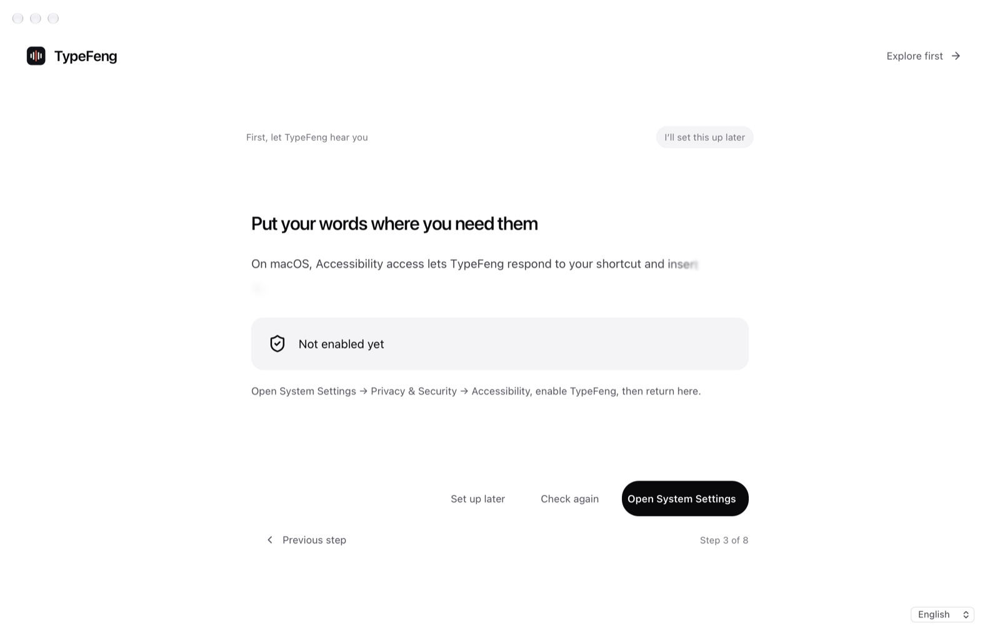
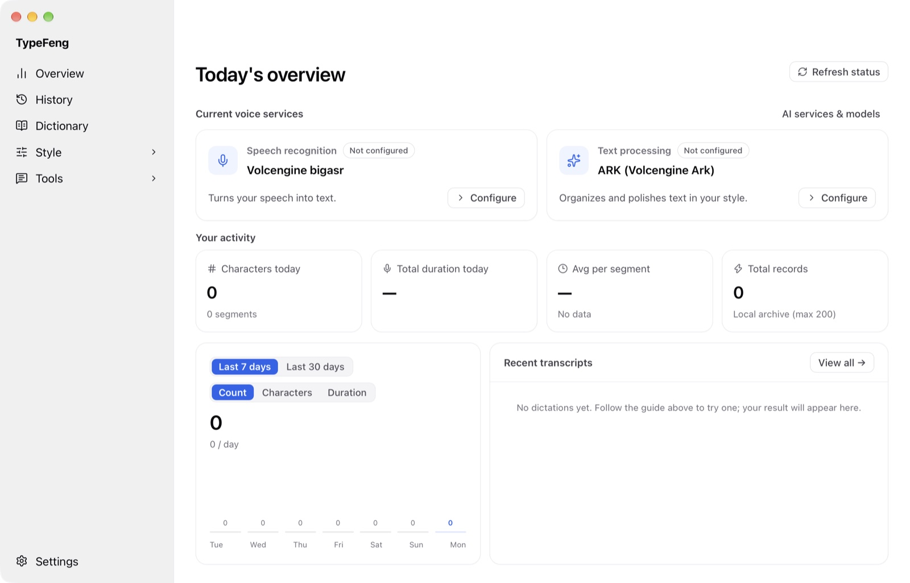

<p align="center">
  
</p>

<h1 align="center">TypeFeng</h1>

<p align="center">
  <strong>按住说话，松手成文。</strong><br/>
  一个本地优先的 macOS 语音输入工具，文字直接落在光标处。
</p>

<p align="center">
  
  
  
  
</p>

<p align="center">
  
</p>

<p align="center">
  
</p>

---

## 这是什么

**TypeFeng 是 [OpenLess](https://github.com/Open-Less/openless) 的一个修改版（fork）**，沿用它的全部核心能力，并做了 TypeFeng 自己的品牌与裁剪：

- 按住快捷键说话，松开后 AI 润色过的文字落在任何应用的光标处；
- 本地 whisper.cpp / sherpa-onnx 与云端 ASR 可选；
- 风格包、词典、剪贴板兜底、听写胶囊、历史记录、跨平台内核；
- 本仓库聚焦 **macOS 桌面端** 的构建与发布。

> 上游版本：OpenLess 2.0.2-Beta.3（提交 `defd6924d9fd634c64acb5e8c78fb8c785e304af`）。
> TypeFeng 与 OpenLess 项目没有隶属或背书关系。

## TypeFeng 改了什么

1. **品牌**：应用名、窗口、托盘、菜单、权限说明、首屏、图标全部改为 TypeFeng；
   Bundle ID 改为 `top.typefeng.desktop`，版本号从 1.0.0 开始。
2. **关闭上游自动更新**：移除上游 Update 端点，前端不再发起更新检查；
   这样不会把 TypeFeng 替换成其他项目的安装包。
3. **移除上游社区入口**：About 页的 QQ 群、Discord、官网等入口已删除，
   GitHub / 文档 / 反馈链接指向本仓库，并新增「上游项目」署名入口。
4. **重新生成 macOS 图标**（含 `.icns`）与关于页图标。
5. **清理上游 CI**：删除只服务于 OpenLess 发布流程的 workflows，
   换成 TypeFeng 的 macOS 构建工作流。
6. **内部 crate 名保持 `openless`**：避免无意义的巨大重命名，方便后续与上游合并；
   用户可见的一切品牌已经是 TypeFeng。

修改时间：2026-11-02。详细清单见 [NOTICE](NOTICE) 与 [docs/typefeng.md](docs/typefeng.md)。

## 安装（从 Release）

1. 下载 `TypeFeng-1.0.0-arm64.dmg`；
2. 拖进「应用程序」；
3. 首次打开若被 Gatekeeper 拦下：右键 → 打开，或执行
   `xattr -dr com.apple.quarantine /Applications/TypeFeng.app`；
4. 按引导授权麦克风与辅助功能，选择本地模型或配置云端 ASR。

> 当前 Release 为 ad-hoc 签名，未做 Apple 公证。

## 从源码构建

要求：macOS 14+（Apple Silicon）、Node.js 22+、Rust 1.99+、Xcode Command Line Tools。

```bash
git clone https://github.com/WilliamFeng7/typefeng.git
cd typefeng/openless-all/app
npm ci
npm run build
npm run tauri -- build --ci --config src-tauri/tauri.macos.conf.json -- --locked
```

产物：

- `src-tauri/target/release/bundle/macos/TypeFeng.app`
- `src-tauri/target/release/bundle/dmg/TypeFeng_1.0.0_aarch64.dmg`

签名相关：本地 ad-hoc 构建可设置 `APPLE_SIGNING_IDENTITY="-"`；
正式分发需自备 Apple Developer ID 与公证流程。

## 权限

TypeFeng 需要：

- **麦克风**：听写；
- **辅助功能**：监听全局快捷键，把结果写进前台应用；
- （可选）**系统播放声音**：回声抑制参考。

权限只在功能被使用时申请，录音默认不离开本机（除非你配置了云端 ASR）。

## 许可证与开源义务

本仓库是 OpenLess 的衍生作品，遵循 **GNU Affero General Public License v3.0（AGPL-3.0）**，
完整文本见 [LICENSE](LICENSE)。上游版权归 OpenLess 作者所有，TypeFeng 的修改版权归
William Feng 与 TypeFeng 贡献者所有，详见 [NOTICE](NOTICE)。

如果你分发 TypeFeng 的二进制，需要同时提供本仓库的完整对应源码，并保留 AGPL 许可与版权声明。
本仓库即对应源码。

上游文档保留在 [docs/upstream/](docs/upstream/)，作为对 OpenLess 项目的引用与致谢。

## English

TypeFeng is a **modified fork of [OpenLess](https://github.com/Open-Less/openless)** (AGPL-3.0),
rebranded for macOS with upstream auto-update and community links removed. It is not affiliated
with the OpenLess project. Build instructions and the change list are above; the full source is
this repository.

## 致谢

- [OpenLess](https://github.com/Open-Less/openless) — 原始项目与全部核心能力
- [whisper.cpp](https://github.com/ggml-org/whisper.cpp) — 本地语音识别
- [Tauri](https://tauri.app/)、[React](https://react.dev/) — 应用外壳与界面
